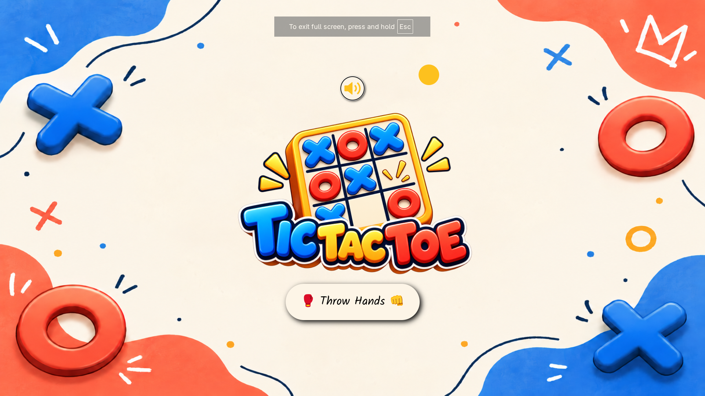
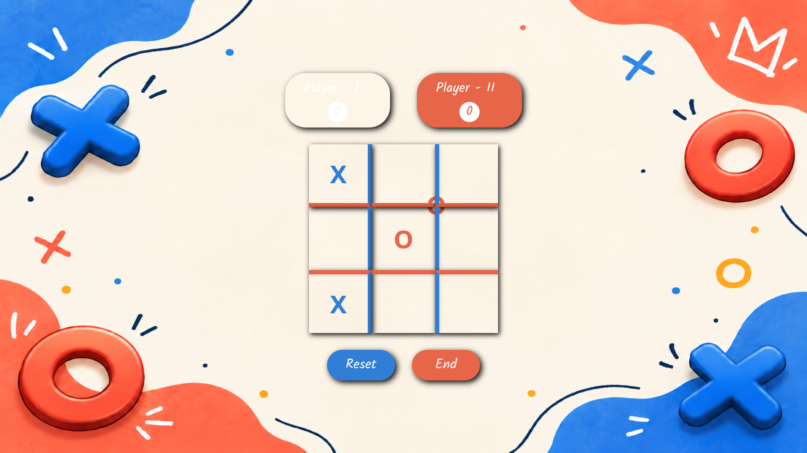
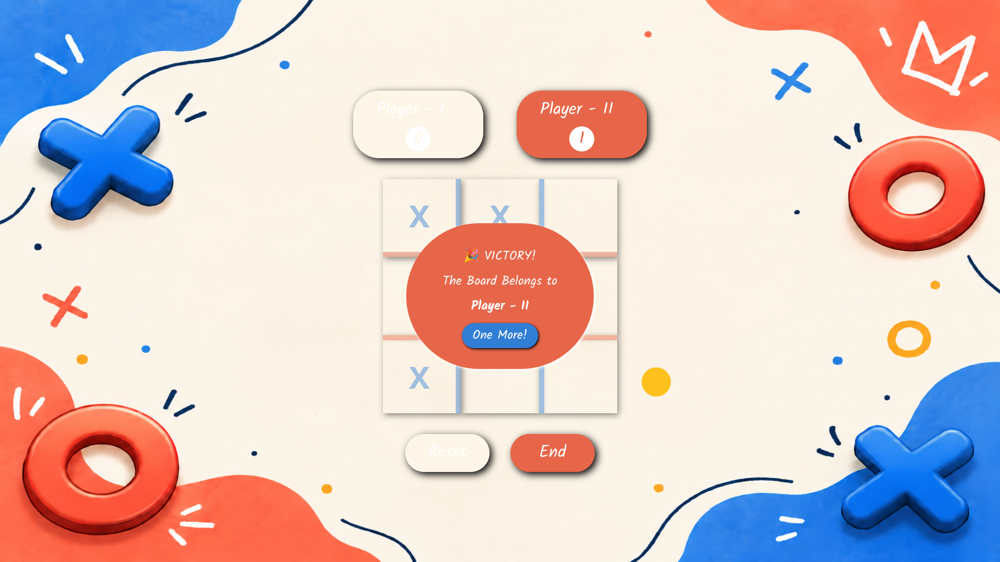
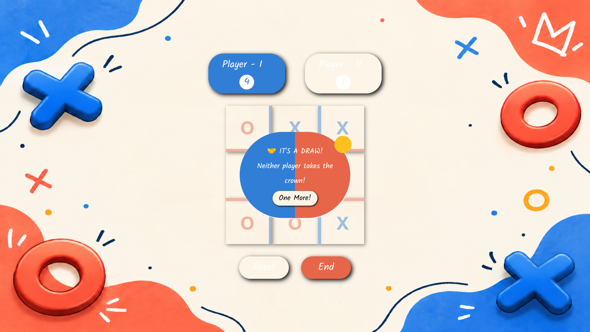

# 🎮 Tic-Tac-Toe: Throw Hands

A playful two-player Tic-Tac-Toe game built with React and TypeScript. Challenge a friend on the same device, customize player names, and keep score through multiple rounds, with game-themed music and a custom cursor.

<!-- Add your deployed website URL when available. -->
<!-- [🎮 Live Demo](YOUR_DEPLOYED_URL) -->

## 📸 Screenshots

### Home Page


### Gameplay


### Winner Screen


### Draw Screen


## ✨ Features

- 🎯 Interactive Tic-Tac-Toe gameplay for two players on one device
- 🏆 Automatic win and draw detection
- 📊 Score tracking across rounds
- ✏️ Editable player names, limited to 10 characters
- 🖱️ Custom cursor that reflects the active player
- 🎵 Optional looping background music with mute/unmute control
- 🔄 Reset the current round or start the next round
- 🎨 Custom game-themed visuals and player colors

## 🛠️ Tech Stack


- **React 19** for the user interface
- **TypeScript** for typed components and game state
- **Tailwind CSS 4** for styling
- **GSAP** and **@gsap/react** for custom cursor movement
- **Vite** for development and production builds
- **Oxlint** for linting

## 🚀 Getting Started

### Prerequisites

Install [Node.js](https://nodejs.org/) and npm.

### Installation

1. Clone the repository:

	```bash
	git clone YOUR_REPOSITORY_URL
	```

2. Move into the project directory:

	```bash
	cd tic-tac-toe
	```

3. Install dependencies and start the development server:

	```bash
	npm install
	npm run dev
	```

4. Open the local URL printed in your terminal.

## 🎲 How to Play

1. Select **Throw Hands** to begin.
2. Set player names in the score panels.
3. Take turns placing marks in empty squares. Connect three in a row, column, or diagonal to win.
4. When the board fills with no winner, the round ends in a draw. Choose the next-round option to keep playing.

## 📁 Project Structure

```text
src/
├── assets/
│   ├── screenshots/       # README gameplay screenshots
│   ├── icons.tsx
│   └── sound.mp3
├── components/
│   ├── Board/             # Board, player panels, controls, and result overlays
│   └── Home.tsx           # Start screen and music control
├── hook/
│   └── useCustomCursor.tsx
├── shared/
│   └── utils.ts
├── UI/                    # Reusable buttons and player panel
├── App.tsx
├── App.css
├── index.css
└── main.tsx
public/
├── bg-image.png
└── logo.png
```

## 📜 Available Scripts

| Command | Description |
|---|---|
| `npm run dev` | Start the development server |
| `npm run build` | Type-check and build the production app in `dist/` |
| `npm run preview` | Preview the production build locally |
| `npm run lint` | Run Oxlint |

## 🧠 What I Learned

- Sharing state across React components with typed props
- Modeling turn-based game state and player scores
- Checking winning patterns and detecting draws
- Integrating GSAP with React refs for a custom cursor
- Organizing a small app into reusable components and hooks

## 🔮 Future Improvements

- Add a single-player mode with an AI opponent
- Support online multiplayer
- Add sound effects for moves and round results
- Introduce more themes and animations

## 🤝 Contributing

Suggestions and improvements are welcome. Fork the repository and open a pull request with your changes.

## 📄 License

This project is licensed under the [MIT License](./LICENSE).
